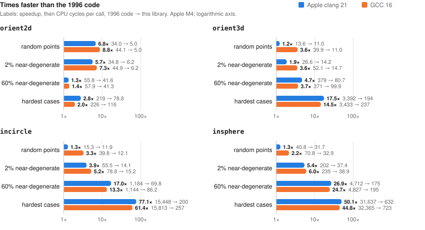

# shewchuk-revisited

Revisiting Jonathan Shewchuk's
[robust geometric predicates](https://www.cs.cmu.edu/~quake/robust.html)
(`orient2d`, `orient3d`, `incircle`, `insphere`) with modern C++: faster, and
still exact.

## Installation and use

Requires CMake 3.20 or newer and a C++20 compiler. Add the repository as a
subdirectory, or fetch it:

```cmake
include(FetchContent)
FetchContent_Declare(shewchuk_revisited
  GIT_REPOSITORY https://github.com/alecjacobson/shewchuk-revisited.git
  GIT_TAG main)
FetchContent_MakeAvailable(shewchuk_revisited)  # or: add_subdirectory(shewchuk-revisited)

target_link_libraries(my_target PRIVATE shewchuk::predicates)
```

```cpp
#include <shewchuk/predicates.h>
#include <cstdio>

int main() {
  const double a[2] = {0.0, 0.0}, b[2] = {1.0, 0.0}, c[2] = {0.5, 1e-30};
  // > 0: counterclockwise, < 0: clockwise, == 0: exactly collinear.
  const double side = shewchuk::orient2d(a, b, c);
  std::printf("%s\n", side > 0 ? "left" : side < 0 ? "right" : "collinear");
}
```

The header declares `orient2d`, `orient3d`, `incircle` and `insphere`, as
`shewchuk::name` in C++ and `shewchuk_name` in C. Only the sign of the result
is exact. It is exact for every finite input, whatever the magnitudes of the
coordinates (the 1996 code silently returns wrong signs when an intermediate
overflows or underflows), provided the caller has not changed the rounding
mode or enabled flush-to-zero; a NaN or infinite coordinate gives NaN.
`shewchuk::orient2d_sign` etc. (`shewchuk_orient2d_sign` in C) return the sign
as an `int`: -1, 0 or +1, and `SHEWCHUK_SIGN_NOT_FINITE` for a NaN or infinite
coordinate. There is no initialization call and no global state. Code written
for the 1996 `predicates.c` can include `<shewchuk/predicates_1996.h>` to get
the original names (`exactinit()` does nothing).

The library must be built by its own CMake files: they compile it with the
floating-point flags that exactness depends on (no contraction into fused
multiply-add, no fast-math), and copying the source into a build with other
flags can silently give wrong signs. Your own code can use any flags. Tested:
GCC and clang on x86-64 and arm64, Apple clang on arm64, MSVC on x86-64.

## Performance

Against the original 1996 `predicates.c`, same compiler and optimization
level, on an Apple M4. "Near-degenerate" inputs are almost collinear,
coplanar, cocircular or cospherical points, where the original falls back to
its slow exact stages; "hardest cases" need its last stage.

<picture>
  <source media="(prefers-color-scheme: dark)" srcset="docs/img/performance-dark.svg">
  
</picture>

Against other exact implementations (CGAL 6.2.1 `EPICK`, Geogram PCK,
Indirect_Predicates, GeometricPredicates), measured the same way
([docs/comparators.md](docs/comparators.md)): this library is the fastest on
mixtures of random and near-degenerate points and on the hardest cases, by 6x
to 10x on the hardest `orient3d`, `incircle` and `insphere` inputs. It is not
the fastest everywhere: on random points Indirect_Predicates' `insphere` is
about 9% faster with Apple clang, and when coordinates span very different
magnitudes its `orient2d` is about 1.4x faster.

Both implementations return the exact sign on every input tested inside the
1996 code's exponent range (over 15 million cases checked against exact
arithmetic); outside it only this library does. The numbers are medians over
10 fresh processes; the chart is regenerated from
[`bench/results`](bench/results) by `tools/readme_chart.py`, and the same
numbers as a table, the method, every workload and a third compiler are in
[docs/benchmarking.md](docs/benchmarking.md). No x86-64 measurements yet.
